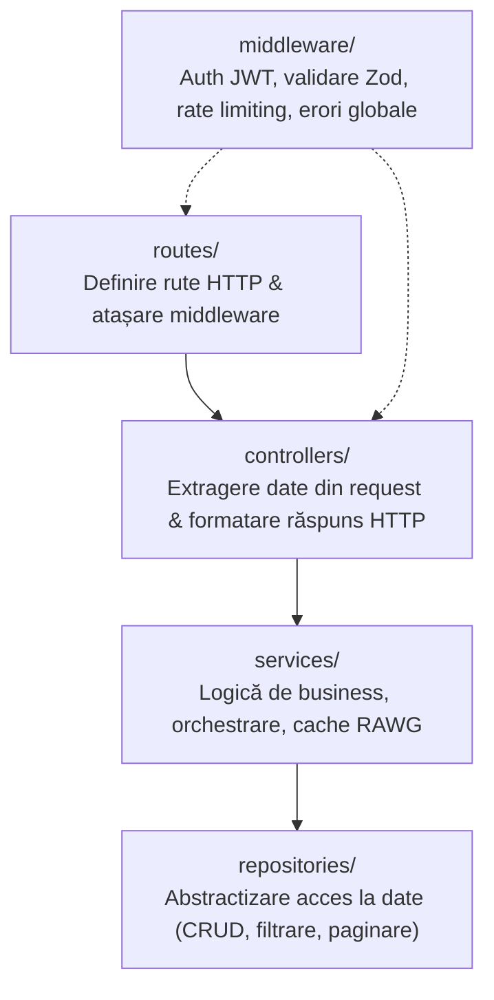
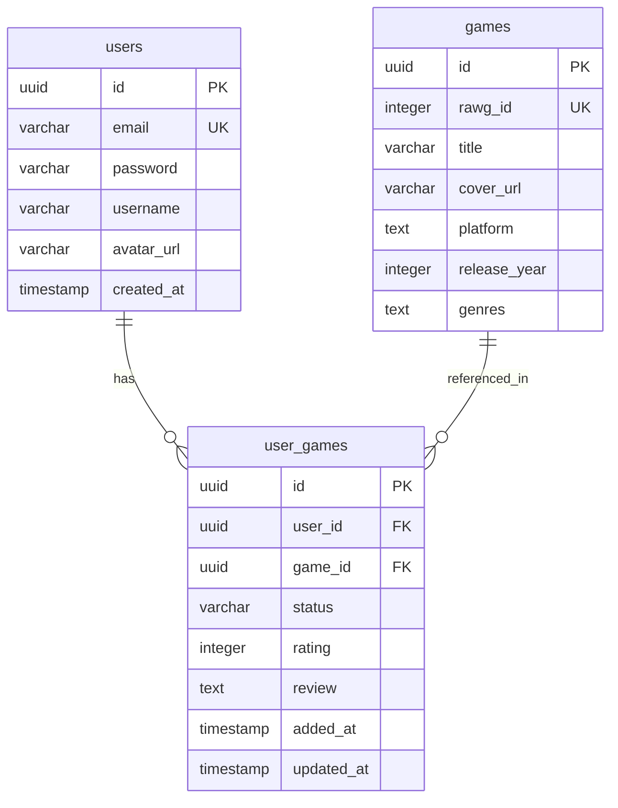
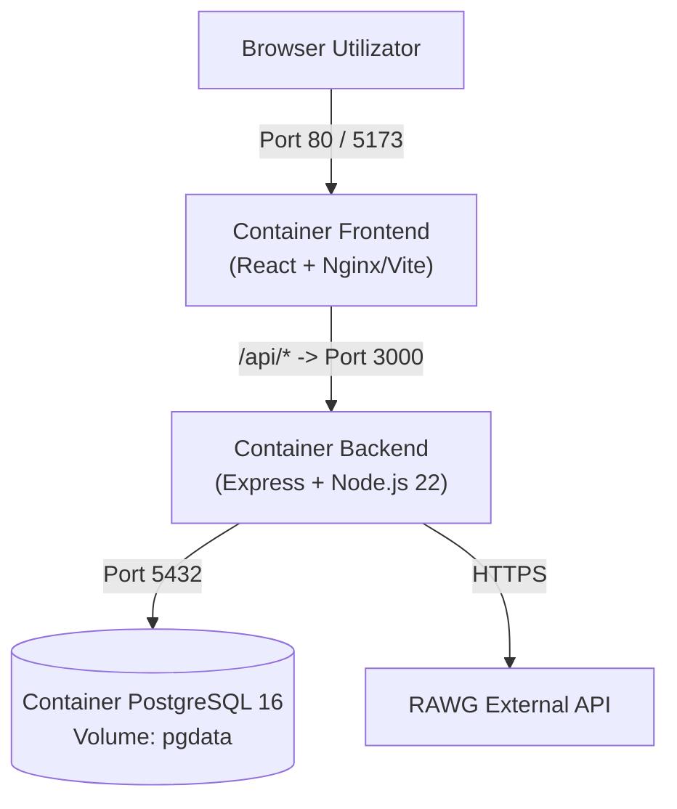

# Document de Arhitectură — GameShelf (CBBFL)

## 1. Prezentare generală (High-Level Architecture)

**GameShelf** este o aplicație web pentru gestionarea bibliotecii personale de jocuri video, construită pe o arhitectură client-server decuplată:

- **Client (Frontend):** Single Page Application dezvoltată în React + TypeScript + Vite + Tailwind CSS.
- **Server (Backend):** REST API stateless dezvoltat în Node.js + Express + TypeScript.
- **Bază de date:** PostgreSQL pentru stocarea persistentă a utilizatorilor, jocurilor și intrărilor din bibliotecă.
- **Serviciu extern:** RAWG Video Games Database API pentru căutarea jocurilor și preluarea metadatelor (titlu, copertă, platforme, an lansare, genuri).

```mermaid
flowchart LR
    Client["Client React (SPA)\nVite + TypeScript"] -->|HTTPS / JSON + JWT| API["REST API Express\n(Node.js + TypeScript)"]
    API -->|SQL / Repository| DB[("PostgreSQL\nusers, games, user_games")]
    API -->|HTTPS + API Key\n(Cache 10 min)| RAWG["API Extern RAWG"]
```

---

## 2. Structura backend pe straturi

Backend-ul este organizat în straturi cu responsabilități clare (`backend/src/`):



| Strat | Director | Responsabilitate |
| :--- | :--- | :--- |
| **Routes** | `src/routes/` | Definirea endpoint-urilor REST și aplicarea middleware-urilor de autentificare, validare și rate limiting |
| **Controllers** | `src/controllers/` | Parsarea parametrilor (`req.body`, `req.query`, `req.params`), apelarea serviciilor și returnarea codurilor HTTP adecvate |
| **Services** | `src/services/` | Logica de business (`authService`, `libraryService`, `gamesService`, `profileService`) |
| **Repositories** | `src/repositories/` | Interfețe și implementări pentru accesul la date (`userRepository`, `gameRepository`, `libraryRepository`) |
| **Middleware** | `src/middleware/` | Verificare JWT, validare scheme `zod`, `express-rate-limit`, tratare uniformă a erorilor (`{ error, message }`) |
| **Utils** | `src/utils/` | Clase de erori HTTP (`AppError`), cache în memorie cu TTL (`MemoryCache`), scheme de validare |

---

## 3. Pattern-uri arhitecturale și de design

1. **MVC (Model–View–Controller adaptat pentru API):** Separarea între rute/controllere (Controller), servicii/modele de domeniu (Model) și frontend-ul React (View).
2. **Repository Pattern:** Serviciile depind de interfețe (`IUserRepository`, `IGameRepository`, `ILibraryRepository`), permițând testarea unitară ușoară cu mock-uri și înlocuirea transparentă a sursei de date (in-memory / PostgreSQL cu Prisma).
3. **Middleware Pipeline:** Procesarea transversală a cererilor (securitate cu `helmet` și `cors`, autentificare JWT, validare `zod`, rate limiting pe `/api/auth/*`, handler global de erori).

---

## 4. Lista endpoint-urilor REST

| Metodă | Rută | Auth | Descriere |
| :--- | :--- | :--- | :--- |
| `GET` | `/api/health` | Nu | Verificare stare server (`{ status: "ok" }`) |
| `POST` | `/api/auth/register` | Nu | Înregistrare utilizator nou (email, parolă min. 8 caractere, username) |
| `POST` | `/api/auth/login` | Nu | Autentificare și emitere token JWT (valabil 24h) |
| `GET` | `/api/games/search?q=...` | Nu | Căutare jocuri în RAWG (cache în memorie 10 minute) |
| `GET` | `/api/games/:rawgId` | Nu | Detalii complete pentru un joc din RAWG |
| `GET` | `/api/library` | Da | Lista jocurilor utilizatorului cu filtrare (`status`, `platform`), sortare (`title`, `rating`, `added_at`) și paginare (`page`, `limit`) |
| `POST` | `/api/library` | Da | Adăugare joc în bibliotecă (preluare metadate din RAWG dacă lipsește din `games`) |
| `PATCH` | `/api/library/:id` | Da | Actualizare `status`, `rating` (1–10) și `review` (max. 1000 caractere) |
| `DELETE` | `/api/library/:id` | Da | Ștergere joc din biblioteca utilizatorului |
| `GET` | `/api/me` | Da | Datele profilului curent (fără `password_hash`) |
| `PATCH` | `/api/me` | Da | Actualizare `username` și `avatarUrl` |
| `GET` | `/api/me/stats` | Da | Statistici bibliotecă (număr jocuri per status, nota medie) |
| `DELETE` | `/api/me` | Da | Ștergere cont și toată biblioteca asociată (GDPR) |

---

## 5. Schema bazei de date

Conform diagramei ER (`docs/design/er-diagram.png`):



---

## 6. Plan pentru atribute de calitate

### Securitate
- **Autentificare JWT:** Token semnat cu `HS256`, valabil 24h, transmis în header-ul `Authorization: Bearer <token>`. La ștergerea contului (`DELETE /api/me`), middleware-ul verifică existența utilizatorului în repository, invalidând efectiv token-urile vechi.
- **Hashing parole:** Parolele sunt stocate exclusiv ca hash `bcrypt` (cost factor 10); câmpul `password_hash` nu este expus niciodată în răspunsurile API.
- **Validare strictă:** Toate body-urile, parametrii de rută și query-urile sunt validate cu `zod`, returnând `400 Bad Request` cu mesaje clare și fără detalii interne.
- **Protecție API:** `helmet` pentru header-e HTTP de securitate, `cors` restricționat la originea frontend-ului (`FRONTEND_URL`), și `express-rate-limit` pe `/api/auth/*` (maximum 10 cereri / minut / IP → `429 Too Many Requests`).
- **Izolare date:** Operațiile pe `/api/library/:id` verifică proprietatea (`item.user_id === req.user.userId`), returnând `403 Forbidden` la acces neautorizat.

### Performanță
- **Cache RAWG în memorie:** Rezultatele căutării și detaliile jocurilor sunt păstrate în cache timp de 10 minute (`MemoryCache`), reducând latența și numărul de apeluri către API-ul extern RAWG.
- **Paginare:** `GET /api/library` limitează rezultatele (`limit` implicit 20, maximum 50).

### Scalabilitate
- **Backend stateless:** Starea sesiunii este purtată de token-ul JWT, permițând rularea mai multor instanțe ale serverului în spatele unui load balancer.
- **Containerizare:** Serviciile sunt izolate în containere Docker orchestrate prin Docker Compose.

---

## 7. Diagrama de deploy (Docker Compose)


